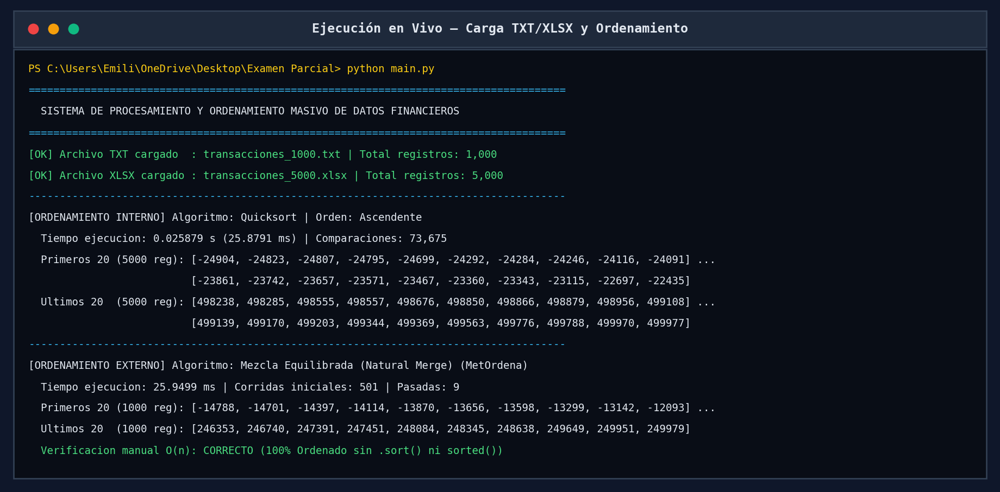

# 📊 Sistema de Procesamiento y Ordenamiento Masivo de Datos

**Examen Parcial — Algoritmos de Ordenamiento y Búsqueda**  
**Materia:** Estructura de Datos | **Alumno:** Emiliano Cab Martínez (`Dark554-hub`)  
**Institución:** Instituto Tecnológico de Mérida (Ingeniería en Sistemas Computacionales)

---

## 🎯 Escenario y Objetivo del Proyecto

Una empresa de análisis financiero recibe miles de registros numéricos diarios relacionados con transacciones y necesita:
1. **Ordenar información rápidamente** (ascendente y descendente) sin depender de funciones automáticas prohibidas (`.sort()` ni `sorted()`).
2. **Buscar valores específicos** de forma eficiente mediante **Búsqueda Secuencial**, **Búsqueda Binaria** y **Tabla Hash**.
3. **Procesar archivos grandes** de **1,000** y **5,000 números enteros** en formatos **TXT** y **XLSX**.
4. **Separar el procesamiento interno y externo**, reutilizando e integrando las librerías propias desarrolladas previamente en la asignatura (`ADA1`, `ADA2` y `MetOrdena`).
5. **Detectar y corregir errores lógicos** en implementaciones defectuosas (índices, recursividad, intercambio incorrecto, manejo de archivos y búsquedas).
6. **Mostrar y exportar resultados** auditables (primeros 20 elementos, últimos 20 elementos, total de registros, tiempo de ejecución y algoritmo utilizado).

---

## 🗂️ Estructura del Repositorio

```text
Examen-Parcial/
├── librerias/                             # Paquete de librerías propias reutilizadas
│   ├── __init__.py                        # Exportador unificado del paquete
│   ├── ordenamientos_internos.py          # 7 algoritmos internos (ADA1 y ADA2): Burbuja, Inserción, Selección, ShellSort, Quicksort, Heapsort, Radix Sort
│   ├── ordenamientos_externos.py          # 3 algoritmos externos (MetOrdena): Intercalación, Mezcla Directa y Mezcla Equilibrada (Auxiliares F1 y F2)
│   ├── busquedas.py                       # Búsqueda Secuencial O(n), Búsqueda Binaria O(log n) y Tabla Hash O(1) con encadenamiento
│   ├── manejo_archivos.py                 # Lectura/Escritura de TXT y XLSX (1,000 y 5,000 enteros), resumen 20/20 y exportación
│   ├── codigo_defectuoso.py               # Diagnóstico y corrección de los 5 casos de código defectuoso
│   └── comparador.py                      # Tabla de comparación por escenario y motor de Benchmarks
├── datos/                                 # Datasets financieros de entrada (1,000 y 5,000 enteros)
│   ├── transacciones_1000.txt             # 1,000 números enteros en formato TXT
│   ├── transacciones_1000.xlsx            # 1,000 números enteros en formato XLSX
│   ├── transacciones_5000.txt             # 5,000 números enteros en formato TXT
│   └── transacciones_5000.xlsx            # 5,000 números enteros en formato XLSX
├── resultados/                            # Archivos ordenados exportados (TXT/XLSX) y auxiliares externos F1/F2
├── capturas/                              # Capturas de ejecución y gráficas comparativas de rendimiento
│   ├── 01_carga_y_ordenamiento.png
│   ├── 02_busquedas_y_exportacion.png
│   ├── 03_correccion_codigo_defectuoso.png
│   └── 04_grafica_comparativa_algoritmos.png
├── tests/                                 # Pruebas unitarias y de integración automatizadas
│   └── test_sistema.py
├── main.py                                # Consola interactiva principal (CLI) + Modo demostración (--demo)
├── app_dashboard.py                       # Dashboard Web Interactivo en Streamlit
├── generar_reporte_y_evidencias.py        # Generador automático del Reporte PDF, DOCX y capturas
├── Reporte_Examen_Parcial_Ordenamiento_Busqueda.pdf   # Reporte Oficial en PDF listo para entrega
├── Reporte_Examen_Parcial_Ordenamiento_Busqueda.docx  # Reporte Oficial editable en Word (.docx)
└── requirements.txt                       # Dependencias permitidas (pandas, openpyxl, matplotlib, streamlit)
```

---

## 🚀 Instrucciones de Ejecución

### 1. Instalar dependencias permitidas
```bash
pip install -r requirements.txt
```
*(Solo se utilizan las bibliotecas permitidas por la rúbrica: `pandas` y `openpyxl` exclusivamente para lectura/escritura de archivos Excel, `time` y `os` para medición y sistema de archivos, además de interfaz visual).*

### 2. Ejecutar el Sistema Interactivo en Consola (En Vivo para Demostración en Clase)
```bash
python main.py
```
Despliega el menú interactivo completo con las opciones **A) Cargar archivo (TXT/XLSX)**, **B) Ordenar datos (10 algoritmos internos/externos, ascendente/descendente)**, **C) Buscar un valor (Secuencial, Binaria, Hash)**, **D) Mostrar primeros 20, últimos 20 y total**, **E) Exportar resultados**, **F) Corrección de código defectuoso** y **G) Comparación y Benchmark**.

### 3. Ejecutar la Demostración Automática Completa (`--demo`)
```bash
python main.py --demo
```
Ejecuta de principio a fin la lectura de los archivos de 1,000 (TXT) y 5,000 (XLSX) enteros, corre los 10 algoritmos de ordenamiento, verifica el orden en $O(n)$, muestra los primeros 20 y últimos 20 elementos, exporta los archivos ordenados, compara las 3 búsquedas y ejecuta los 5 casos de corrección de código defectuoso.

### 4. Ejecutar el Dashboard Web Interactivo (Integración Extra en Streamlit)
```bash
streamlit run app_dashboard.py
```

### 5. Ejecutar la Suite de Pruebas Unitarias
```bash
python -m unittest discover -s tests
```

---

## 📦 Integración de Librerías Propias (Internos y Externos)

Se reutilizaron y adaptaron las librerías propias desarrolladas en el curso (**0% uso de `.sort()` o `sorted()`**):

| Categoría | Algoritmo | Archivo de Librería Propia | Origen Reutilizado | Complejidad |
| :--- | :--- | :--- | :--- | :--- |
| **Interno** | **Burbuja (Bubble Sort)** | `librerias/ordenamientos_internos.py` | `ADA1/burbuja.py` | $O(n^2)$ / $O(n)$ mejor caso |
| **Interno** | **Inserción (Insertion Sort)** | `librerias/ordenamientos_internos.py` | `ADA1/insercion.py` | $O(n^2)$ / $O(n)$ adaptativo |
| **Interno** | **Selección (Selection Sort)** | `librerias/ordenamientos_internos.py` | `ADA1/seleccion.py` | $O(n^2)$ |
| **Interno** | **ShellSort** | `librerias/ordenamientos_internos.py` | `ADA2/shellsort.py` | $O(n \log^2 n)$ |
| **Interno** | **Quicksort** | `librerias/ordenamientos_internos.py` | `ADA2/quicksort.py` | $O(n \log n)$ promedio |
| **Interno** | **Heapsort** | `librerias/ordenamientos_internos.py` | `ADA2/heapsort.py` | $O(n \log n)$ garantizado |
| **Interno** | **Radix Sort (LSD)** | `librerias/ordenamientos_internos.py` | `ADA2/radix.py` | $O(d \cdot n)$ no comparativo |
| **Externo** | **Intercalación** | `librerias/ordenamientos_externos.py` | `MetOrdena/intercalacion.py` | $O(n \log n)$ |
| **Externo** | **Mezcla Directa** | `librerias/ordenamientos_externos.py` | `MetOrdena/mezcla_directa.py` | $O(n \log n)$ (Auxiliares F1/F2) |
| **Externo** | **Mezcla Equilibrada (Natural)** | `librerias/ordenamientos_externos.py` | `MetOrdena/mezcla_equilibrada.py` | $O(n \log n)$ / $O(n)$ por corridas |

---

## 🛠️ Corrección de Código Defectuoso (Requerimiento 4)

En `librerias/codigo_defectuoso.py` se diagnostican, corrigen y prueban en vivo los 5 casos solicitados:
1. **Índices (`IndexError` / Off-by-one en Burbuja):** El ciclo `for j in range(1, n):` omitía el índice `0` y desbordaba al evaluar `lista[j + 1]` en `j = n - 1`. Se corrigió a `range(0, n - 1 - i)`.
2. **Recursividad (`RecursionError` en Quicksort):** La condición base `len(lista) == 0` y la partición `[x for x in lista if x <= pivote]` incluían de nuevo al pivote sin reducir la lista. Se corrigió con `if len(lista) <= 1: return lista` y partición tripartita (`<`, `==`, `>`).
3. **Intercambio Incorrecto (Sobrescritura en Selección):** Asignar `datos[i] = datos[idx_min]` sin respaldar `datos[i]` destruía valores y duplicaba el mínimo. Se corrigió usando variable temporal `temp` / asignación simultánea.
4. **Manejo de Archivos (Orden lexicográfico sobre `str` y fuga de recursos):** `open()` sin `with` ni conversión `int()` ordenaba cadenas por código ASCII (`"1000" < "25"`). Se corrigió con `with open(...)`, `.strip()` y conversión explícita `int()`.
5. **Búsquedas Incorrectas (Ciclo infinito en Búsqueda Binaria):** `while izq < der:` y `izq = medio` estancaban los punteros cuando `der == izq + 1`. Se corrigió a `while izq <= der:` con `izq = medio + 1` y `der = medio - 1`.

---

## 📈 Comparación Básica por Escenario (Requerimiento 6)

| Escenario | Algoritmo Recomendado | Justificación Técnica |
| :--- | :--- | :--- |
| **Datos pequeños** | **Inserción (Insertion Sort)** | Bajo overhead de memoria $O(1)$, sin recursión y alta localidad de caché. |
| **Datos masivos** | **Quicksort / Radix Sort (LSD) / Heapsort** | Complejidad $O(n \log n)$ y $O(d \cdot n)$; ordenan 5,000 registros en `< 18 ms` frente a `> 1,400 ms` de los cuadráticos. |
| **Archivos externos** | **Mezcla Equilibrada (Natural) / Mezcla Directa** | Operan mediante particiones secuenciales y fusión de tramos en archivos auxiliares `F1` y `F2`. |
| **Datos parcialmente ordenados** | **Inserción (Interno) / Mezcla Equilibrada (Externo)** | Adaptativos $O(n)$: aprovechan el orden previo o las corridas naturales sin rehacer trabajo. |
| **Búsquedas frecuentes** | **Tabla Hash $O(1)$ / Búsqueda Binaria $O(\log n)$** | En 5,000 registros, Hash requiere `1-2` comparaciones y Binaria `~12` comparaciones frente a `5,000` de la Secuencial. |

---

## 🖼️ Capturas de Ejecución y Gráficas




