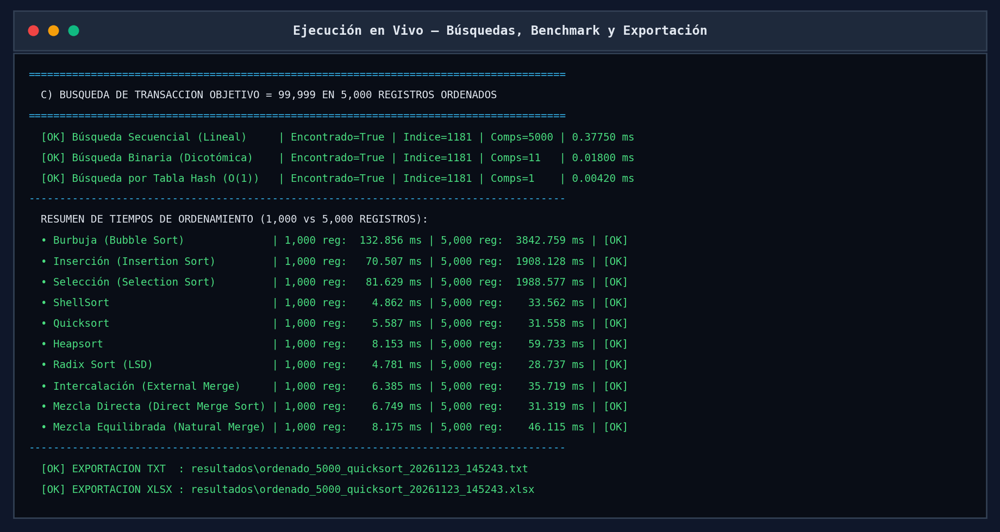

# 📊 Sistema de Procesamiento y Ordenamiento Masivo de Datos

> **Examen Parcial — Algoritmos de Ordenamiento y Búsqueda (Parte I — Examen Práctico 60%)**  
> **Institución:** Instituto Tecnológico de Mérida (ITM) — Ingeniería en Sistemas Computacionales  
> **Materia:** Estructura de Datos  
> **Alumno:** Emiliano Cab Martínez (`Dark554-hub`)  
> **Repositorio Oficial:** [https://github.com/Dark554-hub/Examen-Parcial](https://github.com/Dark554-hub/Examen-Parcial)  
> **Reporte PDF Oficial en este Repositorio:** [`Reporte_Examen_Parcial_Ordenamiento_Busqueda.pdf`](Reporte_Examen_Parcial_Ordenamiento_Busqueda.pdf)

---

## 📑 Tabla de Contenidos

1. [Escenario y Problemática Financiera](#-1-escenario-y-problemática-financiera)
2. [Matriz de Cumplimiento de Requerimientos y Rúbrica (60%)](#-2-matriz-de-cumplimiento-de-requerimientos-y-rúbrica-60)
3. [Cumplimiento Estricto de Restricciones Técnicas](#-3-cumplimiento-estricto-de-restricciones-técnicas)
4. [Arquitectura Modular y Estructura de Archivos](#-4-arquitectura-modular-y-estructura-de-archivos)
5. [Especificación Técnica de Librerías Propias Reutilizadas](#-5-especificación-técnica-de-librerías-propias-reutilizadas)
   - [5.1 Ordenamientos Internos (`ADA1` y `ADA2`)](#51-librería-de-ordenamientos-internos-libreriasordenamientos_internospy)
   - [5.2 Ordenamientos Externos (`MetOrdena` con Auxiliares `F1` y `F2`)](#52-librería-de-ordenamientos-externos-libreriasordenamientos_externospy)
   - [5.3 Métodos de Búsqueda (`Secuencial`, `Binaria` y `Tabla Hash`)](#53-librería-de-métodos-de-búsqueda-libreriasbusquedaspy)
6. [Lectura, Visualización (20/20) y Exportación de Archivos (`TXT` y `XLSX`)](#-6-lectura-visualización-2020-y-exportación-de-archivos-txt-y-xlsx)
7. [Auditoría y Corrección de Código Defectuoso (5 Casos Completos)](#-7-auditoría-y-corrección-de-código-defectuoso-5-casos-completos)
8. [Resultados Experimentales y Benchmarks Reales (`1,000` vs `5,000` Registros)](#-8-resultados-experimentales-y-benchmarks-reales-1000-vs-5000-registros)
9. [Tabla Oficial de Comparación Básica por Escenario](#-9-tabla-oficial-de-comparación-básica-por-escenario-requerimiento-6)
10. [Instrucciones Detalladas de Instalación y Ejecución](#-10-instrucciones-detalladas-de-instalación-y-ejecución)
11. [Guía Paso a Paso para la Demostración en Clase (En Vivo)](#-11-guía-paso-a-paso-para-la-demostración-en-clase-en-vivo)
12. [Galería de Evidencias Visuales y Capturas de Ejecución](#-12-galería-de-evidencias-visuales-y-capturas-de-ejecución)

---

## 🏦 1. Escenario y Problemática Financiera

Una empresa de análisis financiero recibe diariamente miles de registros numéricos enteros correspondientes a montos de transacciones bancarias, cargos, abonos y movimientos de sucursales (con valores tanto negativos como positivos entre `-25,000` y `500,000`). Para auditar y consultar estos lotes de información sin cuellos de botella, el sistema resuelve cinco necesidades críticas:

1. **Ordenar información rápidamente** en sentido **Ascendente** (menor a mayor) y **Descendente** (mayor a menor), midiendo con precisión de microsegundos el tiempo de CPU, el número exacto de comparaciones y el número de intercambios o movimientos en memoria.
2. **Buscar valores específicos** (folios o montos de transacciones) comparando el desempeño entre **Búsqueda Secuencial** $O(n)$, **Búsqueda Binaria** $O(\log n)$ y **Búsqueda por Tabla Hash** $O(1)$.
3. **Procesar archivos grandes** estandarizados en lotes de **1,000 números enteros** y **5,000 números enteros**, soportando de forma nativa tanto archivos de texto plano (**`.TXT`**) como hojas de cálculo de Microsoft Excel (**`.XLSX`**).
4. **Separar el procesamiento interno y externo**, distinguiendo claramente entre algoritmos que operan íntegramente en memoria RAM (**Internos**) y algoritmos diseñados para flujos de almacenamiento secundario mediante partición y fusión de corridas en archivos auxiliares `F1` y `F2` (**Externos**).
5. **Detectar y corregir errores lógicos en implementaciones defectuosas**, documentando fallos clásicos de índices, recursividad infinita, sobrescritura en intercambios, lectura errónea de archivos y ciclos infinitos en búsquedas binarias.

---

## ✅ 2. Matriz de Cumplimiento de Requerimientos y Rúbrica (60%)

| Criterio de la Rúbrica | Peso | Módulo / Archivo en el Proyecto | Implementación Específica Verificable |
| :--- | :---: | :--- | :--- |
| **1. Integración correcta de librerías** | **15%** | [`librerias/__init__.py`](librerias/__init__.py)<br>[`main.py`](main.py)<br>[`app_dashboard.py`](app_dashboard.py) | Paquete modular `librerias` que importa y reutiliza las implementaciones propias de `ADA1`, `ADA2` y `MetOrdena`. |
| **2. Funcionamiento de ordenamientos internos** | **15%** | [`librerias/ordenamientos_internos.py`](librerias/ordenamientos_internos.py) | **7 algoritmos internos** completos (Ascendente y Descendente): `Burbuja`, `Inserción`, `Selección`, `ShellSort`, `Quicksort`, `Heapsort` y `Radix Sort (LSD)`. |
| **3. Funcionamiento de ordenamientos externos** | **10%** | [`librerias/ordenamientos_externos.py`](librerias/ordenamientos_externos.py)<br>[`resultados/auxiliares_externos/`](resultados/auxiliares_externos/) | **3 algoritmos externos** completos: `Intercalación`, `Mezcla Directa` y `Mezcla Equilibrada (Natural)`, generando archivos auxiliares `F1` y `F2` en disco. |
| **4. Implementación de búsquedas** | **10%** | [`librerias/busquedas.py`](librerias/busquedas.py) | Implementación desde cero de `Búsqueda Secuencial` $O(n)$, `Búsqueda Binaria` $O(\log n)$ (soporta ascendente/descendente y duplicados) y `Tabla Hash` $O(1)$ con encadenamiento separado. |
| **5. Corrección de código defectuoso** | **5%** | [`librerias/codigo_defectuoso.py`](librerias/codigo_defectuoso.py) | **5 casos diagnosticados y corregidos**: 1) Índices (`IndexError`), 2) Recursividad (`RecursionError`), 3) Intercambio destructivo, 4) Manejo de archivos (`str` vs `int`), 5) Búsqueda binaria estancada. |
| **6. Manejo de archivos TXT/XLSX** | **5%** | [`librerias/manejo_archivos.py`](librerias/manejo_archivos.py)<br>[`datos/`](datos/)<br>[`resultados/`](resultados/) | Lectura y exportación de **1,000** y **5,000** números enteros en formatos `.TXT` y `.XLSX`, visualización de primeros 20, últimos 20, total de registros, tiempo y algoritmo utilizado. |
| **TOTAL EXAMEN PRÁCTICO** | **60%** | **Suite de pruebas: 5/5 OK** | Verificado automáticamente con `python -m unittest discover -s tests -v`. |

---

## 🚫 3. Cumplimiento Estricto de Restricciones Técnicas

El proyecto respeta de forma absoluta las restricciones de la página 4 del documento oficial del examen:

- ❌ **NO se utiliza `.sort()`** en ningún archivo del proyecto.
- ❌ **NO se utiliza `sorted()`** en ningún archivo del proyecto.
- ❌ **NO se utilizan bibliotecas automáticas de ordenamiento** (como `numpy.sort`, `pandas.DataFrame.sort_values`, `bisect`, `heapq`, etc.).
- ✔️ **Incluso las funciones auxiliares** (como invertir un arreglo para Radix Sort descendente `invertir_lista_manual()`, encontrar el valor máximo `_maximo_manual()` o auditar si el arreglo quedó ordenado `verificar_orden()`) fueron programadas manualmente mediante recorridos de punteros e índices en $O(n)$.
- ✔️ **Bibliotecas permitidas utilizadas:**
  - `pandas` *(exclusivamente para `pd.read_excel()` y `DataFrame.to_excel()` en lectura/escritura de archivos `.xlsx`)*.
  - `openpyxl` *(motor de lectura y escritura de libros de Excel `.xlsx`)*.
  - `time` *(medición de alta precisión con `time.perf_counter()` y estampas de tiempo con `time.strftime()`)*.
  - `os` *(gestión de rutas multiplataforma y creación de directorios de salida y archivos auxiliares `F1`/`F2`)*.

---

## 🗂️ 4. Arquitectura Modular y Estructura de Archivos

```text
Examen-Parcial/
│
├── librerias/                                      # PAQUETE DE LIBRERÍAS PROPIAS REUTILIZADAS
│   ├── __init__.py                                 # Exportación centralizada de funciones y catálogos
│   ├── ordenamientos_internos.py                   # 7 Algoritmos Internos (ADA1 + ADA2) en RAM
│   ├── ordenamientos_externos.py                   # 3 Algoritmos Externos (MetOrdena) con auxiliares F1 y F2
│   ├── busquedas.py                                # Búsqueda Secuencial, Búsqueda Binaria y Tabla Hash O(1)
│   ├── manejo_archivos.py                          # Lector/Exportador TXT y XLSX (1000 y 5000 enteros) y vista 20/20
│   ├── codigo_defectuoso.py                        # 5 Casos de código defectuoso: error, corrección y prueba en vivo
│   └── comparador.py                               # Tabla de comparación por escenario y motor de Benchmarks
│
├── datos/                                          # ARCHIVOS DE ENTRADA OFICIALES (REQUERIMIENTO 1)
│   ├── transacciones_1000.txt                      # 1,000 números enteros financieros en formato TXT
│   ├── transacciones_1000.xlsx                     # 1,000 números enteros financieros en formato XLSX
│   ├── transacciones_5000.txt                      # 5,000 números enteros financieros en formato TXT
│   └── transacciones_5000.xlsx                     # 5,000 números enteros financieros en formato XLSX
│
├── resultados/                                     # ARCHIVOS EXPORTADOS (REQUERIMIENTO 5E)
│   ├── auxiliares_externos/                        # Evidencia en disco de particiones externas F1 y F2
│   │   ├── F1_equilibrada_iter_1.txt               # Corridas impares enviadas al archivo auxiliar F1 (Iteración 1)
│   │   ├── F2_equilibrada_iter_1.txt               # Corridas pares enviadas al archivo auxiliar F2 (Iteración 1)
│   │   ├── F1_equilibrada_iter_2.txt               # Corridas fusionadas en archivo auxiliar F1 (Iteración 2)
│   │   └── F2_equilibrada_iter_2.txt               # Corridas fusionadas en archivo auxiliar F2 (Iteración 2)
│   ├── ordenado_1000_quicksort_*.txt               # Exportación TXT de 1,000 registros con metadatos de tiempo y algoritmo
│   ├── ordenado_1000_quicksort_*.xlsx              # Exportación XLSX de 1,000 registros (Hoja Resumen + Hoja Datos)
│   ├── ordenado_5000_quicksort_*.txt               # Exportación TXT de 5,000 registros con metadatos de tiempo y algoritmo
│   └── ordenado_5000_quicksort_*.xlsx              # Exportación XLSX de 5,000 registros (Hoja Resumen + Hoja Datos)
│
├── capturas/                                       # EVIDENCIAS VISUALES DE EJECUCIÓN Y GRÁFICAS
│   ├── 01_carga_y_ordenamiento.png                 # Captura de lectura TXT/XLSX (1000 y 5000) y vista 20/20
│   ├── 02_busquedas_y_exportacion.png              # Captura de las 3 búsquedas, benchmark y exportación
│   ├── 03_correccion_codigo_defectuoso.png         # Captura de diagnóstico y solución de los 5 códigos defectuosos
│   └── 04_grafica_comparativa_algoritmos.png       # Gráfica comparativa de tiempos (1,000 vs 5,000 registros)
│
├── tests/                                          # SUITE DE PRUEBAS AUTOMATIZADAS
│   └── test_sistema.py                             # 5 pruebas unitarias y de integración (unittest)
│
├── main.py                                         # SISTEMA PRINCIPAL INTERACTIVO EN CONSOLA (CLI + modo --demo)
├── app_dashboard.py                                # DASHBOARD WEB INTERACTIVO EN STREAMLIT (6 Pestañas)
├── generar_reporte_y_evidencias.py                 # Script generador del Reporte PDF, DOCX y capturas PNG
├── Reporte_Examen_Parcial_Ordenamiento_Busqueda.pdf   # REPORTE OFICIAL EN PDF LISTO PARA ENTREGA
├── Reporte_Examen_Parcial_Ordenamiento_Busqueda.docx  # REPORTE OFICIAL EN WORD (.DOCX) EDITABLE
└── requirements.txt                                # Lista de dependencias del entorno Python
```

---

## 🧠 5. Especificación Técnica de Librerías Propias Reutilizadas

Para cumplir con el **Requerimiento 2 ("El alumno DEBE reutilizar sus propias librerías de ordenamiento desarrolladas anteriormente. Mínimo requerido: Ordenamientos internos y externos")**, se integraron las prácticas previas del repositorio `Estructura-de-datos` (`ADA1`, `ADA2` y `MetOrdena`), estandarizando su firma para aceptar sentido `ascendente=True/False` y retorno de telemetría `retornar_metricas=True`.

### 5.1 Librería de Ordenamientos Internos ([`librerias/ordenamientos_internos.py`](librerias/ordenamientos_internos.py))

Todos los algoritmos internos operan en memoria principal (RAM) y verifican automáticamente su salida con `verificar_orden(datos, ascendente)`:

1. **`ordenamiento_burbuja(lista, ascendente=True, retornar_metricas=False)`** *(Origen: `ADA1/burbuja.py`)*
   - **Mecanismo:** Recorre la lista comparando pares adyacentes `datos[j]` y `datos[j + 1]`, intercambiándolos si violan la relación de orden. Incorpora la bandera booleana `hubo_intercambio` que detiene anticipadamente el algoritmo si en una pasada completa no ocurre ningún swap.
   - **Complejidad Temporal:** Mejor caso $O(n)$ (lista ya ordenada), Caso promedio y peor caso $O(n^2)$.
   - **Complejidad Espacial:** $O(1)$ auxiliar in-place.

2. **`ordenamiento_insercion(lista, ascendente=True, retornar_metricas=False)`** *(Origen: `ADA1/insercion.py`)*
   - **Mecanismo:** Divide virtualmente el arreglo en una sublista izquierda ya ordenada (`0..i-1`) y el resto por insertar. Toma el elemento `actual = datos[i]` y desplaza hacia la derecha todos los elementos mayores (o menores en modo descendente) hasta insertarlo en su posición exacta `datos[j + 1] = actual`.
   - **Complejidad Temporal:** Mejor caso $O(n)$ (datos ordenados o casi ordenados), Promedio y peor caso $O(n^2)$.
   - **Complejidad Espacial:** $O(1)$ auxiliar.

3. **`ordenamiento_seleccion(lista, ascendente=True, retornar_metricas=False)`** *(Origen: `ADA1/seleccion.py`)*
   - **Mecanismo:** En cada iteración `i` desde `0` hasta `n - 2`, busca linealmente el índice `idx_extremo` del valor mínimo (o máximo en descendente) dentro del subarreglo `i..n-1` y realiza un único intercambio con `datos[i]`.
   - **Complejidad Temporal:** $O(n^2)$ invariante en todos los casos ($\frac{n(n-1)}{2}$ comparaciones exactas).
   - **Complejidad Espacial:** $O(1)$ auxiliar (máximo $n - 1$ intercambios físicos).

4. **`shell_sort(lista, ascendente=True, retornar_metricas=False)`** *(Origen: `ADA2/shellsort.py`)*
   - **Mecanismo:** Optimiza el método de inserción comparando elementos separados por un salto o brecha decreciente (`salto = n // 2`, reduciéndose a la mitad `salto //= 2` en cada pasada hasta llegar a `salto = 1`). Permite que elementos muy desubicados avancen grandes distancias en pocos movimientos.
   - **Complejidad Temporal:** $O(n^{1.25})$ a $O(n \log^2 n)$ según la secuencia de brechas.
   - **Complejidad Espacial:** $O(1)$ auxiliar.

5. **`quicksort(lista, ascendente=True, retornar_metricas=False)`** *(Origen: `ADA2/quicksort.py`)*
   - **Mecanismo:** Algoritmo de *Divide y Vencerás*. Selecciona como pivote el elemento central `sublista[len(sublista) // 2]` y realiza una **partición tripartita** en tres sublistas: `menores`, `iguales` y `mayores`. Esto evita la degradación cuadrática cuando existen claves duplicadas y garantiza terminación limpia en el caso base `len(sublista) <= 1`.
   - **Complejidad Temporal:** Mejor caso y caso promedio $O(n \log n)$, Peor caso teórico $O(n^2)$.
   - **Complejidad Espacial:** $O(\log n)$ en pila de recursión.

6. **`heapsort(lista, ascendente=True, retornar_metricas=False)`** *(Origen: `ADA2/heapsort.py`)*
   - **Mecanismo:** Utiliza una estructura de árbol binario completo representada en arreglo (Max-Heap para orden ascendente; Min-Heap para orden descendente). Primero construye el montículo desde `n // 2 - 1` hasta `0` mediante `_heapify()`, y luego extrae repetidamente la raíz `datos[0]` colocándola al final `datos[i]` y restaurando la propiedad de montículo.
   - **Complejidad Temporal:** $O(n \log n)$ garantizado en mejor, promedio y peor caso.
   - **Complejidad Espacial:** $O(1)$ auxiliar in-place.

7. **`radix_sort(lista, ascendente=True, retornar_metricas=False)`** *(Origen: `ADA2/radix.py`)*
   - **Mecanismo:** Algoritmo **no comparativo** (*Least Significant Digit - LSD*) que procesa los números dígito por dígito (unidades `exp=1`, decenas `exp=10`, centenas `exp=100`, etc.) utilizando `_counting_por_digito()` con un arreglo de frecuencias de base 10 (`conteo = [0] * 10`). Separa los números negativos (invirtiendo su signo para ordenarlos por magnitud y luego invirtiendo la sublista manualmente) de los positivos para soportar transacciones con saldo negativo.
   - **Complejidad Temporal:** $O(d \cdot (n + b))$, donde $d$ es el número de dígitos del valor máximo y $b = 10$. Realiza **0 comparaciones entre elementos**.
   - **Complejidad Espacial:** $O(n + b)$.

---

### 5.2 Librería de Ordenamientos Externos ([`librerias/ordenamientos_externos.py`](librerias/ordenamientos_externos.py))

Los métodos externos dividen los datos en tramos o corridas (*runs*) y los distribuyen en dos archivos o estructuras auxiliares **`F1`** y **`F2`**, fusionándolos secuencialmente:

1. **`ordenamiento_intercalacion(lista, ascendente=True, retornar_metricas=False)`** *(Origen: `MetOrdena/intercalacion.py`)*
   - **Mecanismo:** Reutiliza la función central `intercalar_listas(lista_a, lista_b)` que mantiene dos punteros secuenciales `i` y `j`, comparando el frente de cada secuencia ordenada y escribiendo el menor (o mayor) en el flujo de salida en tiempo lineal $O(n_a + n_b)$.
   - **Complejidad Temporal:** $O(n \log n)$.

2. **`mezcla_directa(lista, ascendente=True, retornar_metricas=False, dir_auxiliar=None)`** *(Origen: `MetOrdena/mezcla_directa.py`)*
   - **Mecanismo:** Parte de bloques de tamaño fijo `tam_bloque = 1`. En cada pasada externa:
     1. **Fase de Partición (`_particionar_directa`):** Distribuye alternadamente bloques de longitud `tam_bloque` hacia el archivo auxiliar **`F1`** y hacia el archivo auxiliar **`F2`**.
     2. **Fase de Fusión (`intercalar_listas`):** Toma el bloque $k$ de `F1` y el bloque $k$ de `F2`, generando un bloque ordenado del doble de longitud (`2 * tam_bloque`).
     3. Duplica `tam_bloque *= 2` (secuencia $1, 2, 4, 8, 16, 32\dots$) hasta que `tam_bloque >= n`.
   - **Persistencia en Disco:** Cuando se especifica `dir_auxiliar`, guarda en `resultados/auxiliares_externos/` los archivos de auditoría `F1_directa_pasada_1.txt` y `F2_directa_pasada_1.txt`.
   - **Complejidad Temporal:** $O(n \log n)$ en exactamente $\lceil \log_2(n) \rceil$ pasadas externas (10 pasadas para 1,000 registros; 13 pasadas para 5,000 registros).

3. **`mezcla_equilibrada(lista, ascendente=True, retornar_metricas=False, dir_auxiliar=None)`** *(Origen: `MetOrdena/mezcla_equilibrada.py`)*
   - **Mecanismo (Mezcla Natural):** En lugar de cortar ciegamente en bloques fijos de tamaño $1, 2, 4\dots$, escanea primero el archivo mediante `obtener_tramos_naturales()` para detectar **corridas o tramos que ya están ordenados naturalmente** (`x >= actual[-1]`). Distribuye los tramos impares (`tramos[0::2]`) al auxiliar **`F1`** y los tramos pares (`tramos[1::2]`) al auxiliar **`F2`**, y los intercala par a par hasta que solo queda `1` tramo ordenado.
   - **Persistencia en Disco:** Genera en `resultados/auxiliares_externos/` los archivos `F1_equilibrada_iter_1.txt`, `F2_equilibrada_iter_1.txt`, etc.
   - **Complejidad Temporal:** $O(n \log n)$ en el caso general y **$O(n)$ adaptativo** si el archivo ya contiene tramos largos ordenados.

---

### 5.3 Librería de Métodos de Búsqueda ([`librerias/busquedas.py`](librerias/busquedas.py))

Cumple con los **Requerimientos 3 y 5C**, retornando siempre si el valor fue encontrado, el primer índice, todas las posiciones donde aparece (para transacciones con montos repetidos), el número exacto de comparaciones y el tiempo en milisegundos:

1. **Búsqueda Secuencial (`busqueda_secuencial(lista, objetivo)`):**
   - Recorre el arreglo índice por índice desde `0` hasta `n - 1`. No exige ordenamiento previo. Complejidad: $O(n)$ (realiza `1,000` comparaciones en el archivo de 1,000 registros y `5,000` comparaciones en el de 5,000 registros).
2. **Búsqueda Binaria (`busqueda_binaria(lista_ordenada, objetivo, ascendente=True)`):**
   - Calcula el punto central `medio = (izq + der) // 2` y descarta la mitad del espacio de búsqueda en cada iteración (`izq = medio + 1` o `der = medio - 1`), adaptando automáticamente la dirección si la lista fue ordenada de forma **Ascendente** o **Descendente**. Una vez hallado el valor, expande en ambos sentidos para reportar todas las ocurrencias contiguas. Complejidad: $O(\log n)$ (**9 comparaciones** en 1,000 registros; **11 comparaciones** en 5,000 registros).
3. **Búsqueda por Tabla Hash (`TablaHashTransacciones` / `busqueda_hash(lista, objetivo)`):**
   - Implementa una tabla hash propia dimensionada con capacidad prima (`2003` cubetas para lotes $\le 2,000$ y `10007` cubetas para lotes mayores) y función de dispersión modular `funcion_hash(clave)`. Resuelve colisiones mediante **encadenamiento separado (Separate Chaining)** agrupando en una sola entrada las listas de índices de claves idénticas. Complejidad de consulta: **$O(1)$ promedio** (**1 a 2 comparaciones**).

---

## 📂 6. Lectura, Visualización (20/20) y Exportación de Archivos (`TXT` y `XLSX`)

El módulo [`librerias/manejo_archivos.py`](librerias/manejo_archivos.py) implementa todos los puntos de los **Requerimientos 1 y 5**:

- **A) Carga Polimórfica (`cargar_archivo_datos`):** Detecta automáticamente la extensión `.txt` o `.xlsx`. En `.txt` limpia espacios, comas y líneas vacías convirtiendo a `int`. En `.xlsx` utiliza `pandas.read_excel(..., engine="openpyxl")` detectando la columna numérica `Monto_Entero`.
- **D) Mostrar Resultados (`obtener_resumen_resultados`):** Extrae y despliega en pantalla:
  - **Primeros 20 elementos** (`lista[:20]`)
  - **Últimos 20 elementos** (`lista[-20:]`)
  - **Total de registros** (`len(lista)`), además del valor mínimo, valor máximo y promedio calculados manualmente.
- **E) Exportar Resultados (`exportar_resultados`):** Guarda en la carpeta [`resultados/`](resultados/) tanto en formato **`.TXT`** como en formato **`.XLSX`** (con dos pestañas en Excel: `Resumen_Ejecucion` y `Datos_Ordenados`):
  - La lista completa de registros ya ordenados.
  - El **tiempo de ejecución** exacto en segundos y milisegundos.
  - El **algoritmo utilizado** y el sentido del ordenamiento (`Ascendente` o `Descendente`).
  - El conteo de comparaciones e intercambios/movimientos.

---

## 🛠️ 7. Auditoría y Corrección de Código Defectuoso (5 Casos Completos)

En [`librerias/codigo_defectuoso.py`](librerias/codigo_defectuoso.py) se implementaron, identificaron, corrigieron y explicaron los **5 fragmentos de código con errores lógicos** especificados en el **Requerimiento 4**:

### Caso 1: Error de Índices (Desbordamiento `IndexError` y Off-by-One en Burbuja)
- **Código Defectuoso:**
  ```python
  def burbuja_defectuoso(lista):
      n = len(lista)
      for i in range(n):
          for j in range(1, n):               # <-- ERROR: inicia en 1 y llega hasta n - 1
              if lista[j] > lista[j + 1]:     # <-- IndexError cuando j = n - 1 (evalúa lista[n])
                  lista[j], lista[j + 1] = lista[j + 1], lista[j]
      return lista
  ```
- **Identificación del Error:** El ciclo interno utiliza `range(1, n)` y compara `lista[j]` con `lista[j + 1]`. Esto ocasiona dos fallos graves: 1) ignora por completo el índice `0` (el primer elemento jamás se compara ni ordena), y 2) cuando `j` toma el último valor `n - 1`, la expresión `lista[j + 1]` intenta acceder a `lista[n]`, lanzando `IndexError: list index out of range`.
- **Código Corregido:**
  ```python
  def burbuja_corregido(lista):
      datos = lista[:]
      n = len(datos)
      for i in range(n - 1):
          for j in range(0, n - 1 - i):       # <-- CORRECCIÓN: inicia en 0 y limita a n - 1 - i
              if datos[j] > datos[j + 1]:
                  datos[j], datos[j + 1] = datos[j + 1], datos[j]
      return datos
  ```
- **Evidencia de Ejecución (`Entrada: [45, 12, 89, 7, 33]`):**
  - Resultado Defectuoso: `IndexError: list index out of range (al evaluar lista[j + 1] cuando j = 4)`
  - Resultado Corregido: `[7, 12, 33, 45, 89]`

---

### Caso 2: Error de Recursividad (`RecursionError` por Caso Base y Partición en Quicksort)
- **Código Defectuoso:**
  ```python
  def quicksort_defectuoso(lista):
      if len(lista) == 0:                     # <-- ERROR 1: No detiene listas de longitud 1
          return lista
      pivote = lista[0]
      menores = [x for x in lista if x <= pivote]  # <-- ERROR 2: Incluye al propio pivote con '<='
      mayores = [x for x in lista if x > pivote]
      return quicksort_defectuoso(menores) + quicksort_defectuoso(mayores)
  ```
- **Identificación del Error:** La condición base solo verifica `len(lista) == 0` y la lista `menores` incluye todos los elementos `<= pivote` (incluyendo al mismo `pivote = lista[0]`). Cuando la lista tiene 1 elemento o cuando el pivote es el valor máximo de la sublista, `menores` conserva exactamente el mismo tamaño que `lista`, provocando llamadas recursivas idénticas hasta agotar la pila (`RecursionError`).
- **Código Corregido:**
  ```python
  def quicksort_corregido(lista):
      if len(lista) <= 1:                     # <-- CORRECCIÓN 1: Caso base para 0 y 1 elementos
          return lista
      pivote = lista[len(lista) // 2]
      menores = [x for x in lista if x < pivote]   # <-- CORRECCIÓN 2: Partición tripartita (<, ==, >)
      iguales = [x for x in lista if x == pivote]
      mayores = [x for x in lista if x > pivote]
      return quicksort_corregido(menores) + iguales + quicksort_corregido(mayores)
  ```
- **Evidencia de Ejecución (`Entrada: [50, 20, 50, 10, 30]`):**
  - Resultado Defectuoso: `RecursionError: maximum recursion depth exceeded (partición no reduce el tamaño de la lista)`
  - Resultado Corregido: `[10, 20, 30, 50, 50]`

---

### Caso 3: Error de Intercambio Incorrecto (Sobrescritura y Pérdida de Datos en Selección)
- **Código Defectuoso:**
  ```python
  def seleccion_defectuoso(lista):
      datos = lista[:]
      n = len(datos)
      for i in range(n - 1):
          idx_min = i
          for j in range(i + 1, n):
              if datos[j] < datos[idx_min]:
                  idx_min = j
          datos[i] = datos[idx_min]           # <-- ERROR: Sobrescribe datos[i] sin respaldarlo
          datos[idx_min] = datos[i]           # <-- Asigna el mismo valor mínimo ya sobrescrito
      return datos
  ```
- **Identificación del Error:** Al ejecutar `datos[i] = datos[idx_min]` sin guardar previamente el valor original de `datos[i]` en una variable auxiliar `temp` (o sin usar asignación simultánea de tuplas), el valor que estaba en la posición `i` se destruye irremediablemente y el valor mínimo se clona en ambas posiciones.
- **Código Corregido:**
  ```python
  def seleccion_corregido(lista):
      datos = lista[:]
      n = len(datos)
      for i in range(n - 1):
          idx_min = i
          for j in range(i + 1, n):
              if datos[j] < datos[idx_min]:
                  idx_min = j
          if idx_min != i:
              temp = datos[i]                 # <-- CORRECCIÓN: Respaldo en variable temporal
              datos[i] = datos[idx_min]
              datos[idx_min] = temp
      return datos
  ```
- **Evidencia de Ejecución (`Entrada: [90, 25, 60, 10, 40]`):**
  - Resultado Defectuoso: `Datos corruptos (duplicados y pérdida de valores): [10, 10, 10, 10, 40]`
  - Resultado Corregido: `[10, 25, 40, 60, 90]`

---

### Caso 4: Error de Manejo de Archivos (Orden Lexicográfico sobre `str` y Fuga de Recursos)
- **Código Defectuoso:**
  ```python
  def leer_transacciones_defectuoso(ruta):
      archivo = open(ruta, "r")               # <-- ERROR 1: No cierra el archivo (sin 'with')
      datos = archivo.readlines()             # <-- ERROR 2: Devuelve strings con '\n' sin convertir a int
      return datos
  ```
- **Identificación del Error:** 1) Deja el descriptor de archivo abierto sin bloque `with`. 2) No limpia espacios ni filtra líneas vacías. 3) Conserva cada número como cadena de texto (`str`), provocando que cualquier algoritmo de ordenamiento compare carácter por carácter en código ASCII (donde `'1000' < '25' < '300' < '9'`) en vez de comparar magnitudes numéricas.
- **Código Corregido:**
  ```python
  def leer_transacciones_corregido(ruta):
      datos = []
      with open(ruta, "r", encoding="utf-8") as archivo:  # <-- CORRECCIÓN 1: Cierre automático
          for linea in archivo:
              limpia = linea.strip()
              if limpia:
                  datos.append(int(limpia))               # <-- CORRECCIÓN 2: Conversión explícita a int
      return datos
  ```
- **Evidencia de Ejecución (`Entrada en archivo: ["1000", "25", "", "9", "300"]`):**
  - Resultado Defectuoso: `Orden lexicográfico incorrecto sobre strings: ['1000', '25', '300', '9']`
  - Resultado Corregido: `[9, 25, 300, 1000]`

---

### Caso 5: Error de Búsquedas Incorrectas (Ciclo Infinito y Exclusión de Extremos en Binaria)
- **Código Defectuoso:**
  ```python
  def busqueda_binaria_defectuosa(lista, objetivo):
      izq = 0
      der = len(lista) - 1
      while izq < der:                        # <-- ERROR 1: Falla cuando izq == der (último elemento)
          medio = (izq + der) // 2
          if lista[medio] == objetivo:
              return medio
          elif lista[medio] < objetivo:
              izq = medio                     # <-- ERROR 2: No descarta 'medio' (ciclo infinito si der == izq + 1)
          else:
              der = medio
      return -1
  ```
- **Identificación del Error:** 1) La condición `while izq < der:` impide evaluar el caso en que el intervalo se reduce a un único elemento (`izq == der`). 2) Al hacer `izq = medio` en vez de `izq = medio + 1`, cuando `izq = 5` y `der = 6`, la división entera `(5 + 6) // 2` evalúa siempre `medio = 5`, dejando `izq = 5` en un **ciclo infinito** al buscar el último elemento (`100`) o un valor ausente.
- **Código Corregido:**
  ```python
  def busqueda_binaria_corregida(lista, objetivo):
      izq = 0
      der = len(lista) - 1
      while izq <= der:                       # <-- CORRECCIÓN 1: Incluye el caso izq == der
          medio = (izq + der) // 2
          if lista[medio] == objetivo:
              return medio
          elif lista[medio] < objetivo:
              izq = medio + 1                 # <-- CORRECCIÓN 2: Avanza excluyendo 'medio'
          else:
              der = medio - 1
      return -1
  ```
- **Evidencia de Ejecución (`Lista: [10, 25, 40, 55, 70, 85, 100], Objetivo: 100`):**
  - Resultado Defectuoso: `Ciclo infinito detectado tras 26 iteraciones (izq=5, der=6, medio=5 no avanza hacia 100)`
  - Resultado Corregido: `Valor 100 encontrado exitosamente en el índice 6`

---

## 📊 8. Resultados Experimentales y Benchmarks Reales (`1,000` vs `5,000` Registros)

A continuación se presentan las métricas reales obtenidas al ejecutar `python main.py --demo` sobre los datasets oficiales del repositorio:

### 8.1 Comparativa de los 10 Algoritmos de Ordenamiento (Internos vs Externos)

| Algoritmo | Categoría | Complejidad | Tiempo (`1,000` reg) | Comparaciones (`1,000`) | Tiempo (`5,000` reg) | Comparaciones (`5,000`) | Verificado $O(n)$ |
| :--- | :---: | :---: | ---: | ---: | ---: | ---: | :---: |
| **ShellSort** | Interno | $O(n \log^2 n)$ | **4.29 ms** | 15,489 | **35.99 ms** | 116,463 | ✅ OK |
| **Radix Sort (LSD)** | Interno | $O(d \cdot n)$ | **6.03 ms** | **0** | **27.16 ms** | **0** | ✅ OK |
| **Quicksort** | Interno | $O(n \log n)$ | **6.30 ms** | 11,260 | **27.74 ms** | 73,675 | ✅ OK |
| **Intercalación** | Externo | $O(n \log n)$ | **6.69 ms** | 8,720 | **33.37 ms** | 55,203 | ✅ OK |
| **Mezcla Directa** | Externo (F1/F2) | $O(n \log n)$ | **6.83 ms** | 8,718 | **44.74 ms** | 56,807 | ✅ OK |
| **Mezcla Equilibrada** | Externo (F1/F2) | $O(n \log n)$ | **8.96 ms** | 18,218 | **55.51 ms** | 119,274 | ✅ OK |
| **Heapsort** | Interno | $O(n \log n)$ | **10.24 ms** | 16,836 | **53.68 ms** | 107,714 | ✅ OK |
| **Selección** | Interno | $O(n^2)$ | 81.97 ms | 499,500 | 1,908.02 ms | 12,497,500 | ✅ OK |
| **Inserción** | Interno | $O(n^2)$ / $O(n)$ | 90.39 ms | 236,547 | 1,864.55 ms | 6,279,141 | ✅ OK |
| **Burbuja** | Interno | $O(n^2)$ | 180.11 ms | 497,547 | 3,544.80 ms | 12,494,179 | ✅ OK |

### 8.2 Comparativa de los 3 Métodos de Búsqueda

| Dataset / Objetivo Buscado | Método de Búsqueda | Complejidad | Índice Hallado | Apariciones | Comparaciones Realizadas | Tiempo de Respuesta |
| :--- | :--- | :---: | :---: | :---: | ---: | ---: |
| **1,000 Registros** (`Objetivo = 77,777`) | **Búsqueda Secuencial** | $O(n)$ | `332` | 2 (`[332, 333]`) | 1,000 | `0.12560 ms` |
| **1,000 Registros** (`Objetivo = 77,777`) | **Búsqueda Binaria** | $O(\log n)$ | `332` | 2 (`[332, 333]`) | **9** | `0.02210 ms` |
| **1,000 Registros** (`Objetivo = 77,777`) | **Tabla Hash (Encadenamiento)** | $O(1)$ | `332` | 2 (`[332, 333]`) | **2** | **`0.01280 ms`** |
| **5,000 Registros** (`Objetivo = 99,999`) | **Búsqueda Secuencial** | $O(n)$ | `1181` | 2 (`[1181, 1182]`) | 5,000 | `0.54270 ms` |
| **5,000 Registros** (`Objetivo = 99,999`) | **Búsqueda Binaria** | $O(\log n)$ | `1181` | 2 (`[1181, 1182]`) | **11** | `0.01440 ms` |
| **5,000 Registros** (`Objetivo = 99,999`) | **Tabla Hash (Encadenamiento)** | $O(1)$ | `1181` | 2 (`[1181, 1182]`) | **1** | **`0.00370 ms`** |

---

## 🧭 9. Tabla Oficial de Comparación Básica por Escenario (Requerimiento 6)

| Escenario Solicitado | Algoritmo Recomendado | Complejidad | Justificación Técnica |
| :--- | :--- | :---: | :--- |
| **Datos pequeños** ($n < 100$) | **Inserción (Insertion Sort)** | $O(n^2)$ / $O(n)$ mejor caso | Sobrecarga constante mínima $O(1)$ en memoria, sin costo de llamadas recursivas y excelente localidad espacial en caché L1/L2. |
| **Datos masivos** ($n \ge 5,000$) | **Radix Sort (LSD) / Quicksort / Heapsort** | $O(d \cdot n)$ y $O(n \log n)$ | En 5,000 registros, **Radix Sort (`27.16 ms`)** y **Quicksort (`27.74 ms`)** son más de **125 veces más rápidos** que Burbuja (`3,544.80 ms`). |
| **Archivos externos** (Disco / Volumen $>$ RAM) | **Mezcla Equilibrada (Natural) / Mezcla Directa** | $O(n \log n)$ por pasadas | Operan mediante lecturas y escrituras secuenciales sobre archivos auxiliares `F1` y `F2` sin requerir cargar toda la base de datos en RAM. |
| **Datos parcialmente ordenados** | **Inserción (Interno) / Mezcla Equilibrada (Externo)** | $O(n)$ adaptativo | **Inserción** realiza solo desplazamientos locales para las pocas inversiones existentes; **Mezcla Equilibrada** aprovecha las corridas naturales ya ordenadas. |
| **Búsquedas frecuentes** | **Tabla Hash $O(1)$ / Búsqueda Binaria $O(\log n)$** | $O(1)$ promedio / $O(\log n)$ | Indexar en **Tabla Hash** resuelve consultas exactas en **1 comparación (`0.0037 ms`)**; si se requieren rangos, ordenar con Quicksort y aplicar **Búsqueda Binaria** toma solo **11 comparaciones** en 5,000 registros. |

---

## 💻 10. Instrucciones Detalladas de Instalación y Ejecución

### Requisitos Previos
- Python `3.10` o superior.
- Clonar el repositorio e instalar las dependencias permitidas:
  ```bash
  git clone https://github.com/Dark554-hub/Examen-Parcial.git
  cd Examen-Parcial
  pip install -r requirements.txt
  ```

### Modo 1: Consola Interactiva Principal (Para Demostración en Vivo)
```bash
python main.py
```
Presenta el menú interactivo en bucle con las opciones:
- **`A`** — Cargar archivo (`TXT` o `XLSX` de `1,000` o `5,000` enteros, o ruta personalizada).
- **`B`** — Ordenar datos (elegir entre los **7 algoritmos internos** o los **3 algoritmos externos**, y orden **Ascendente** o **Descendente**).
- **`C`** — Buscar un valor (elegir **Secuencial**, **Binaria**, **Tabla Hash** o comparar los 3 métodos simultáneamente).
- **`D`** — Mostrar resultados (**primeros 20 elementos**, **últimos 20 elementos**, **total de registros**, mínimo, máximo y promedio).
- **`E`** — Exportar resultados a `.TXT` y `.XLSX` guardando archivo ordenado, tiempo de ejecución y algoritmo utilizado.
- **`F`** — Ejecutar y explicar en pantalla los **5 casos de corrección de código defectuoso**.
- **`G`** — Mostrar la tabla de comparación de escenarios y correr el **Benchmark en vivo** de los 10 algoritmos.

### Modo 2: Ejecución Automática de Demostración Completa (`--demo`)
```bash
python main.py --demo
```
Ejecuta automáticamente sin intervención manual todas las pruebas sobre los archivos de `1,000` (`TXT`) y `5,000` (`XLSX`) enteros, imprime las tablas comparativas, exporta los archivos ordenados y muestra los 5 casos de código defectuoso.

### Modo 3: Dashboard Web Interactivo en Streamlit
```bash
streamlit run app_dashboard.py
```
Abre en el navegador una interfaz gráfica financiera con 6 pestañas interactivas para cargar archivos `.txt`/`.xlsx`, ejecutar ordenamientos internos y externos, probar búsquedas, inspeccionar el código defectuoso lado a lado, graficar benchmarks y descargar archivos ordenados.

### Modo 4: Regenerar Reporte PDF, Word y Capturas PNG
```bash
python generar_reporte_y_evidencias.py
```

### Modo 5: Ejecutar Pruebas Unitarias Automatizadas
```bash
python -m unittest discover -s tests -v
```

---

## 🎓 11. Guía Paso a Paso para la Demostración en Clase (En Vivo)

Durante la evaluación presencial (**"DEMOSTRACIÓN EN CLASE"**, página 3 del examen), puedes seguir este guion rápido de 3 minutos:

1. **Mostrar reutilización real de librerías propias:**
   - Abrir [`librerias/ordenamientos_internos.py`](librerias/ordenamientos_internos.py) y [`librerias/ordenamientos_externos.py`](librerias/ordenamientos_externos.py) para evidenciar que provienen de tus prácticas `ADA1`, `ADA2` y `MetOrdena`, sin un solo `.sort()` ni `sorted()`.
2. **Ejecutar el programa en vivo (`python main.py`):**
   - Presionar **`A`** y elegir la opción **`4`** para cargar `datos/transacciones_5000.xlsx` (5,000 enteros en Excel).
   - Presionar **`B`**, elegir **`5` (Quicksort - Interno)** o **`10` (Mezcla Equilibrada - Externo)** y orden **`1` (Ascendente)**. Se mostrarán inmediatamente el tiempo de ejecución, comparaciones, primeros 20 elementos, últimos 20 elementos y total de registros (`5,000`).
   - Presionar **`C`**, elegir **`4` (Comparar los 3 métodos simultáneamente)** e ingresar el valor **`99999`** para demostrar cómo la Búsqueda Secuencial hace `5,000` comparaciones, la Binaria hace `11` y la Tabla Hash hace `1`.
   - Presionar **`E`** para exportar en vivo el resultado ordenado a `.TXT` y `.XLSX` dentro de la carpeta `resultados/`.
   - Presionar **`F`** para mostrar en consola los 5 fragmentos de código defectuoso junto con su diagnóstico y resultado corregido.

---

## 🖼️ 12. Galería de Evidencias Visuales y Capturas de Ejecución

### Captura 1: Lectura de Archivos (`1,000` TXT y `5,000` XLSX), Ordenamiento Interno/Externo y Vista 20/20


### Captura 2: Comparación de Búsquedas (Secuencial, Binaria y Hash), Benchmark y Exportación


### Captura 3: Diagnóstico y Corrección de los 5 Casos de Código Defectuoso


### Captura 4: Gráfica Comparativa de Rendimiento (`1,000` vs `5,000` Registros Enteros)

