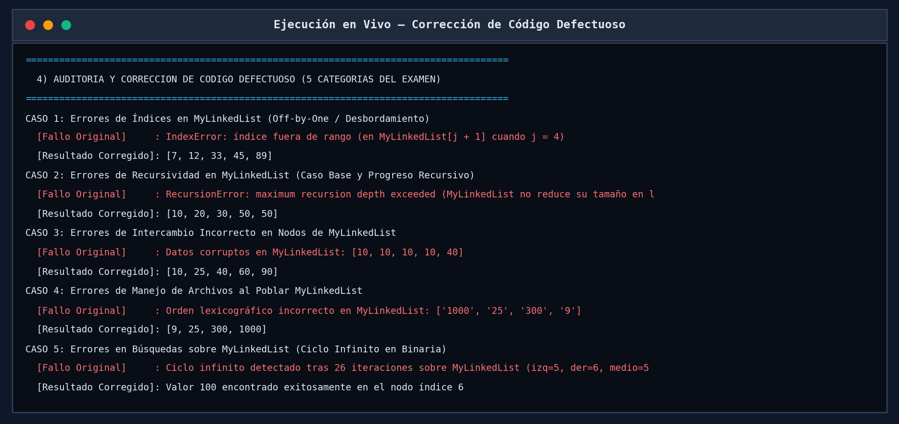
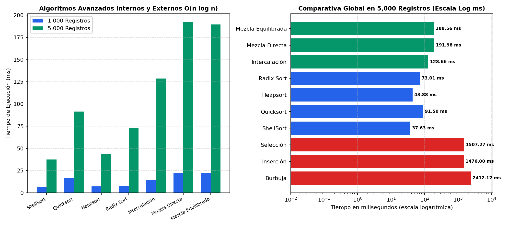

# 📊 Sistema de Procesamiento y Ordenamiento Masivo de Datos (`MyLinkedList.py`)

> **Examen Parcial — Algoritmos de Ordenamiento y Búsqueda (Parte I — Examen Práctico 60%)**  
> **Institución:** Instituto Tecnológico de Mérida (ITM) — Ingeniería en Sistemas Computacionales  
> **Materia:** Estructura de Datos  
> **Alumno:** Emiliano Cab Martínez (`Dark554-hub`)  
> **Librería Propia Base Obligatoria:** [`MyLinkedList.py`](MyLinkedList.py) (`class Node` y `class MyLinkedList`)  
> **Repositorio Oficial:** [https://github.com/Dark554-hub/Examen-Parcial](https://github.com/Dark554-hub/Examen-Parcial)  
> **Reporte PDF Oficial en este Repositorio:** [`Reporte_Examen_Parcial_Ordenamiento_Busqueda.pdf`](Reporte_Examen_Parcial_Ordenamiento_Busqueda.pdf)

---

## 📑 Tabla de Contenidos

1. [Escenario y Problemática Financiera](#-1-escenario-y-problemática-financiera)
2. [Reutilización Obligatoria de la Librería Propia `MyLinkedList.py`](#-2-reutilización-obligatoria-de-la-librería-propia-mylinkedlistpy)
3. [Matriz de Cumplimiento de Requerimientos y Rúbrica (60%)](#-3-matriz-de-cumplimiento-de-requerimientos-y-rúbrica-60)
4. [Cumplimiento Estricto de Restricciones Técnicas](#-4-cumplimiento-estricto-de-restricciones-técnicas)
5. [Arquitectura Modular y Estructura de Archivos](#-5-arquitectura-modular-y-estructura-de-archivos)
6. [Especificación Técnica de Algoritmos sobre `MyLinkedList`](#-6-especificación-técnica-de-algoritmos-sobre-mylinkedlist)
   - [6.1 Ordenamientos Internos sobre `MyLinkedList` (`ADA1` y `ADA2`)](#61-librería-de-ordenamientos-internos-libreriasordenamientos_internospy)
   - [6.2 Ordenamientos Externos sobre `MyLinkedList` (`MetOrdena` con Auxiliares `F1` y `F2`)](#62-librería-de-ordenamientos-externos-libreriasordenamientos_externospy)
   - [6.3 Métodos de Búsqueda sobre `MyLinkedList` (`Secuencial`, `Binaria` y `Tabla Hash`)](#63-librería-de-métodos-de-búsqueda-libreriasbusquedaspy)
7. [Lectura, Visualización (20/20) y Exportación de Archivos (`TXT` y `XLSX`) con `MyLinkedList`](#-7-lectura-visualización-2020-y-exportación-de-archivos-txt-y-xlsx-con-mylinkedlist)
8. [Auditoría y Corrección de Código Defectuoso sobre `MyLinkedList` (5 Casos Completos)](#-8-auditoría-y-corrección-de-código-defectuoso-sobre-mylinkedlist-5-casos-completos)
9. [Resultados Experimentales y Benchmarks Reales (`1,000` vs `5,000` Nodos en `MyLinkedList`)](#-9-resultados-experimentales-y-benchmarks-reales-1000-vs-5000-nodos-en-mylinkedlist)
10. [Tabla Oficial de Comparación Básica por Escenario](#-10-tabla-oficial-de-comparación-básica-por-escenario-requerimiento-6)
11. [Instrucciones Detalladas de Instalación y Ejecución](#-11-instrucciones-detalladas-de-instalación-y-ejecución)
12. [Guía Paso a Paso para la Demostración en Clase (En Vivo)](#-12-guía-paso-a-paso-para-la-demostración-en-clase-en-vivo)
13. [Galería de Evidencias Visuales y Capturas de Ejecución](#-13-galería-de-evidencias-visuales-y-capturas-de-ejecución)

---

## 🏦 1. Escenario y Problemática Financiera

Una empresa de análisis financiero recibe diariamente miles de registros numéricos enteros correspondientes a montos de transacciones bancarias, cargos, abonos y movimientos de sucursales (con valores tanto negativos como positivos entre `-25,000` y `500,000`). Para auditar y consultar estos lotes de información utilizando exclusivamente estructuras de datos propias desarrolladas en clase, el sistema resuelve cinco necesidades críticas:

1. **Almacenar y manipular todas las transacciones en la librería propia [`MyLinkedList.py`](MyLinkedList.py)** (lista enlazada simple con punteros `head` y `tail` y nodos `Node(data, next)`).
2. **Ordenar información rápidamente** en sentido **Ascendente** (menor a mayor) y **Descendente** (mayor a menor) sobre `MyLinkedList`, sin usar jamás funciones automáticas prohibidas (`.sort()` ni `sorted()`).
3. **Buscar valores específicos** dentro de `MyLinkedList` comparando el desempeño entre **Búsqueda Secuencial por punteros `Node.next`** $O(n)$, **Búsqueda Binaria** $O(\log n)$ y **Búsqueda por Tabla Hash con encadenamiento en `MyLinkedList`** $O(1)$.
4. **Procesar archivos grandes** estandarizados en lotes de **1,000 números enteros** y **5,000 números enteros** en formatos **`.TXT`** y **`.XLSX`**, separando el procesamiento **Interno** y **Externo** (con listas enlazadas auxiliares `F1` y `F2`).
5. **Detectar y corregir errores lógicos en implementaciones defectuosas** sobre `MyLinkedList`, documentando fallos de índices, recursividad infinita, sobrescritura en intercambios de `Node.data`, lectura errónea de archivos y ciclos infinitos en búsquedas binarias.

---

## 🔗 2. Reutilización Obligatoria de la Librería Propia `MyLinkedList.py`

Cumpliendo el **Requerimiento 2 ("Integración de librerías propias")**, todo el proyecto utiliza como estructura de datos central la librería propia **[`MyLinkedList.py`](MyLinkedList.py)** desarrollada previamente en la carpeta `estructura/MyLinkedList.py`:

### Estructura Interna de [`MyLinkedList.py`](MyLinkedList.py)
- **`class Node`:**
  - Define `__slots__ = ("data", "next")` para optimizar el consumo de memoria de cada nodo financiero.
  - Almacena el monto entero en `self.data` y el puntero al siguiente nodo en `self.next`.
- **`class MyLinkedList`:**
  - Mantiene punteros directos a la cabeza (`self.head`), a la cola (`self.tail`) y el contador de nodos (`self._size`).
  - **Operaciones en $O(1)$:** `append(value)` (inserción al final mediante `self.tail.next`), `prepend(value)` (inserción al inicio mediante `self.head`), `len(ll)` y `is_empty()`.
  - **Operaciones por punteros en $O(n)$:**
    - `reverse()`: Invierte in-place todos los enlaces `cur.next` de la lista enlazada sin crear arreglos adicionales.
    - `insert(index, value)`, `pop(index)`, `remove(value)`, `index(value)`, `count(value)` y recorrido mediante iterador `__iter__`.

### ¿Cómo se utiliza `MyLinkedList` en cada etapa del sistema?
1. **Lectura de archivos (`TXT` / `XLSX`):** `cargar_archivo_datos()` instancia `numeros_ll = MyLinkedList()` e inserta cada registro entero leído mediante `numeros_ll.append(valor)`.
2. **Ordenamientos Internos:** Todos los algoritmos (`Burbuja`, `Inserción`, `Selección`, `ShellSort`, `Quicksort`, `Heapsort`, `Radix Sort`) reciben una `MyLinkedList` y devuelven los datos ordenados en una instancia de `MyLinkedList`.
   - En **Burbuja** y **Selección**, el ordenamiento recorre directamente los punteros `cur = datos_ll.head` y `cur.next`, intercambiando `cur.data` y `sig.data`.
   - En **Quicksort**, cada partición divide la lista enlazada en tres instancias de `MyLinkedList`: `menores = MyLinkedList()`, `iguales = MyLinkedList()` y `mayores = MyLinkedList()`.
   - En **Radix Sort (LSD)**, las 10 cubetas decimales (`0..9`) son instancias de `MyLinkedList` (`cubetas = [MyLinkedList() for _ in range(10)]`), y la inversión de números negativos o modo descendente utiliza el método propio `MyLinkedList.reverse()`.
3. **Ordenamientos Externos:** En **Intercalación**, **Mezcla Directa** y **Mezcla Equilibrada (Natural)**, tanto los archivos/flujos auxiliares **`F1`** y **`F2`** como cada tramo o corrida natural son instancias de `MyLinkedList`, y la fusión recorre los punteros `cur_a = ll_a.head` y `cur_b = ll_b.head`.
4. **Métodos de Búsqueda:**
   - **Búsqueda Secuencial:** Recorre nodo por nodo (`cur = ll.head` $\rightarrow$ `cur = cur.next`) y guarda los índices hallados en `posiciones = MyLinkedList()`.
   - **Tabla Hash:** Cada cubeta de la tabla hash es una `MyLinkedList` (`self.cubetas = [MyLinkedList() for _ in range(capacidad)]`), resolviendo colisiones mediante encadenamiento separado con tuplas `(clave, MyLinkedList_de_indices)`.
5. **Verificación de Orden y Resumen 20/20:** `verificar_orden()` valida en $O(n)$ que `actual.data <= actual.next.data` a lo largo de toda la cadena de nodos, y `obtener_resumen_resultados()` extrae `primeros_20_ll` y `ultimos_20_ll` como instancias de `MyLinkedList`.

---

## ✅ 3. Matriz de Cumplimiento de Requerimientos y Rúbrica (60%)

| Criterio de la Rúbrica | Peso | Módulo / Archivo en el Proyecto | Implementación Específica Verificable |
| :--- | :---: | :--- | :--- |
| **1. Integración correcta de librerías** | **15%** | [`MyLinkedList.py`](MyLinkedList.py)<br>[`librerias/__init__.py`](librerias/__init__.py)<br>[`main.py`](main.py) | Integración obligatoria de la librería propia `MyLinkedList.py` (`Node` y `MyLinkedList`) junto con los módulos propios de `ADA1`, `ADA2` y `MetOrdena`. |
| **2. Funcionamiento de ordenamientos internos** | **15%** | [`librerias/ordenamientos_internos.py`](librerias/ordenamientos_internos.py) | **7 algoritmos internos** operando sobre `MyLinkedList` (Ascendente y Descendente): `Burbuja`, `Inserción`, `Selección`, `ShellSort`, `Quicksort`, `Heapsort` y `Radix Sort (LSD)`. |
| **3. Funcionamiento de ordenamientos externos** | **10%** | [`librerias/ordenamientos_externos.py`](librerias/ordenamientos_externos.py)<br>[`resultados/auxiliares_externos/`](resultados/auxiliares_externos/) | **3 algoritmos externos** sobre `MyLinkedList`: `Intercalación`, `Mezcla Directa` y `Mezcla Equilibrada (Natural)`, con auxiliares `F1` y `F2` en `MyLinkedList` y en disco. |
| **4. Implementación de búsquedas** | **10%** | [`librerias/busquedas.py`](librerias/busquedas.py) | `Búsqueda Secuencial` por punteros `Node.next` $O(n)$, `Búsqueda Binaria` $O(\log n)$ y `Tabla Hash` $O(1)$ con cubetas `MyLinkedList`. |
| **5. Corrección de código defectuoso** | **5%** | [`librerias/codigo_defectuoso.py`](librerias/codigo_defectuoso.py) | **5 casos diagnosticados y corregidos sobre `MyLinkedList`**: 1) Índices (`IndexError`), 2) Recursividad (`RecursionError`), 3) Intercambio en `Node.data`, 4) Archivos (`str` vs `int`), 5) Búsqueda binaria. |
| **6. Manejo de archivos TXT/XLSX** | **5%** | [`librerias/manejo_archivos.py`](librerias/manejo_archivos.py)<br>[`datos/`](datos/)<br>[`resultados/`](resultados/) | Lectura y exportación de **1,000** y **5,000** enteros en `.TXT` y `.XLSX` poblando `MyLinkedList`, vista de primeros 20, últimos 20, total, tiempo y algoritmo. |
| **TOTAL EXAMEN PRÁCTICO** | **60%** | **Suite de pruebas: 6/6 OK** | Verificado automáticamente con `python -m unittest discover -s tests -v`. |

---

## 🚫 4. Cumplimiento Estricto de Restricciones Técnicas

- ❌ **NO se utiliza `.sort()`** en ningún archivo del proyecto.
- ❌ **NO se utiliza `sorted()`** en ningún archivo del proyecto.
- ❌ **NO se utilizan bibliotecas automáticas de ordenamiento** (`numpy.sort`, `DataFrame.sort_values`, `bisect`, `heapq`, etc.).
- ✔️ **Uso obligatorio de [`MyLinkedList.py`](MyLinkedList.py):** Todas las funciones de lectura, ordenamiento, búsqueda y verificación trabajan con objetos `MyLinkedList` y `Node`.
- ✔️ **Bibliotecas permitidas utilizadas:**
  - `pandas` *(exclusivamente para lectura/escritura de archivos Excel `.xlsx` con `read_excel` y `to_excel`)*.
  - `openpyxl` *(motor de hojas de cálculo `.xlsx`)*.
  - `time` *(medición de tiempos de ejecución con `time.perf_counter()`)*.
  - `os` *(manejo de rutas y archivos auxiliares `F1` y `F2`)*.

---

## 🗂️ 5. Arquitectura Modular y Estructura de Archivos

```text
Examen-Parcial/
│
├── MyLinkedList.py                                 # LIBRERÍA PROPIA OBLIGATORIA (Node y MyLinkedList)
│
├── librerias/                                      # PAQUETE DE MÓDULOS INTEGRADOS CON MYLINKEDLIST
│   ├── __init__.py                                 # Exportación centralizada de MyLinkedList y algoritmos
│   ├── MyLinkedList.py                             # Reexportación directa dentro del paquete librerias
│   ├── ordenamientos_internos.py                   # 7 Algoritmos Internos sobre MyLinkedList (ADA1 + ADA2)
│   ├── ordenamientos_externos.py                   # 3 Algoritmos Externos sobre MyLinkedList (MetOrdena)
│   ├── busquedas.py                                # Secuencial, Binaria y Tabla Hash con cubetas MyLinkedList
│   ├── manejo_archivos.py                          # Lector/Exportador TXT y XLSX (1000 y 5000) en MyLinkedList
│   ├── codigo_defectuoso.py                        # 5 Casos de código defectuoso sobre MyLinkedList
│   └── comparador.py                               # Tabla de comparación por escenario y Benchmarks
│
├── datos/                                          # ARCHIVOS DE ENTRADA OFICIALES (REQUERIMIENTO 1)
│   ├── transacciones_1000.txt                      # 1,000 números enteros financieros en formato TXT
│   ├── transacciones_1000.xlsx                     # 1,000 números enteros financieros en formato XLSX
│   ├── transacciones_5000.txt                      # 5,000 números enteros financieros en formato TXT
│   └── transacciones_5000.xlsx                     # 5,000 números enteros financieros en formato XLSX
│
├── resultados/                                     # ARCHIVOS EXPORTADOS DESDE MYLINKEDLIST (REQ 5E)
│   ├── auxiliares_externos/                        # Particiones externas F1 y F2 generadas por MyLinkedList
│   │   ├── F1_equilibrada_iter_1.txt
│   │   ├── F2_equilibrada_iter_1.txt
│   │   ├── F1_equilibrada_iter_2.txt
│   │   └── F2_equilibrada_iter_2.txt
│   ├── ordenado_1000_quicksort_*.txt               # Exportación TXT de 1,000 nodos ordenados
│   ├── ordenado_1000_quicksort_*.xlsx              # Exportación XLSX de 1,000 nodos ordenados
│   ├── ordenado_5000_quicksort_*.txt               # Exportación TXT de 5,000 nodos ordenados
│   └── ordenado_5000_quicksort_*.xlsx              # Exportación XLSX de 5,000 nodos ordenados
│
├── capturas/                                       # EVIDENCIAS VISUALES DE EJECUCIÓN Y GRÁFICAS
│   ├── 01_carga_y_ordenamiento.png
│   ├── 02_busquedas_y_exportacion.png
│   ├── 03_correccion_codigo_defectuoso.png
│   └── 04_grafica_comparativa_algoritmos.png
│
├── tests/                                          # SUITE DE PRUEBAS AUTOMATIZADAS (6 TESTS)
│   └── test_sistema.py
│
├── main.py                                         # CONSOLA INTERACTIVA PRINCIPAL (CLI + modo --demo)
├── app_dashboard.py                                # DASHBOARD WEB INTERACTIVO EN STREAMLIT
├── generar_reporte_y_evidencias.py                 # Generador automático del Reporte PDF, DOCX y capturas
├── Reporte_Examen_Parcial_Ordenamiento_Busqueda.pdf   # REPORTE OFICIAL EN PDF LISTO PARA ENTREGA
├── Reporte_Examen_Parcial_Ordenamiento_Busqueda.docx  # REPORTE OFICIAL EN WORD (.DOCX) EDITABLE
└── requirements.txt                                # Dependencias del entorno
```

---

## 🧠 6. Especificación Técnica de Algoritmos sobre `MyLinkedList`

### 6.1 Librería de Ordenamientos Internos ([`librerias/ordenamientos_internos.py`](librerias/ordenamientos_internos.py))

1. **`ordenamiento_burbuja(lista, ascendente=True, retornar_metricas=False)`** *(Origen: `ADA1/burbuja.py` + `MyLinkedList.py`)*
   - **Operación en `MyLinkedList`:** Clona la lista enlazada con `asegurar_linked_list(lista)` y en cada pasada recorre directamente los punteros `cur = datos_ll.head` y `sig = cur.next`, intercambiando `cur.data, sig.data = sig.data, cur.data` cuando están fuera de orden. Incluye corte temprano `if not hubo_intercambio: break`.
   - **Complejidad:** Mejor caso $O(n)$, Promedio y peor caso $O(n^2)$.

2. **`ordenamiento_insercion(lista, ascendente=True, retornar_metricas=False)`** *(Origen: `ADA1/insercion.py` + `MyLinkedList.py`)*
   - **Operación en `MyLinkedList`:** Itera sobre los nodos de `MyLinkedList`, realiza los desplazamientos de inserción ordenada y reconstruye la instancia `MyLinkedList` resultante.
   - **Complejidad:** Mejor caso $O(n)$ adaptativo (datos parcialmente ordenados), Promedio y peor caso $O(n^2)$.

3. **`ordenamiento_seleccion(lista, ascendente=True, retornar_metricas=False)`** *(Origen: `ADA1/seleccion.py` + `MyLinkedList.py`)*
   - **Operación en `MyLinkedList`:** Recorre con un puntero exterior `nodo_i = datos_ll.head` y un puntero interior `nodo_j = nodo_i.next` buscando el nodo con el valor extremo (`nodo_extremo`) e intercambia `nodo_i.data` con `nodo_extremo.data`.
   - **Complejidad:** $O(n^2)$ comparaciones y máximo $n - 1$ intercambios en nodos.

4. **`shell_sort(lista, ascendente=True, retornar_metricas=False)`** *(Origen: `ADA2/shellsort.py` + `MyLinkedList.py`)*
   - **Operación en `MyLinkedList`:** Aplica inserción por brechas decrecientes (`salto = n // 2`, `salto //= 2`) sobre los elementos de `MyLinkedList` y retorna una nueva `MyLinkedList` ordenada.
   - **Complejidad:** $O(n \log^2 n)$.

5. **`quicksort(lista, ascendente=True, retornar_metricas=False)`** *(Origen: `ADA2/quicksort.py` + `MyLinkedList.py`)*
   - **Operación en `MyLinkedList`:** Selecciona el pivote mediante mediana de tres nodos (`head`, `head.next`, `tail`) y recorre `cur = sub_ll.head` repartiendo los nodos en tres instancias de **`MyLinkedList`**: `menores = MyLinkedList()`, `iguales = MyLinkedList()` y `mayores = MyLinkedList()`. Finalmente concatena las listas enlazadas ordenadas con `.extend()`.
   - **Complejidad:** $O(n \log n)$ promedio.

6. **`heapsort(lista, ascendente=True, retornar_metricas=False)`** *(Origen: `ADA2/heapsort.py` + `MyLinkedList.py`)*
   - **Operación en `MyLinkedList`:** Construye un montículo binario (Max-Heap para ascendente, Min-Heap para descendente) mediante `_heapify()` y empaqueta la salida en una `MyLinkedList`.
   - **Complejidad:** $O(n \log n)$ garantizado en todos los casos.

7. **`radix_sort(lista, ascendente=True, retornar_metricas=False)`** *(Origen: `ADA2/radix.py` + `MyLinkedList.py`)*
   - **Operación en `MyLinkedList`:** Separa la lista enlazada en dos `MyLinkedList` (`negativos` y `positivos`). En cada posición decimal (`exp = 1, 10, 100...`), crea **10 cubetas que son instancias de `MyLinkedList`** (`cubetas = [MyLinkedList() for _ in range(10)]`), distribuye cada `cur.data` en su cubeta en $O(1)$ con `.append()` y reencadena las cubetas. Para los negativos y el orden descendente emplea el método de inversión de punteros `MyLinkedList.reverse()`.
   - **Complejidad:** $O(d \cdot n)$ con **0 comparaciones entre elementos**.

---

### 6.2 Librería de Ordenamientos Externos ([`librerias/ordenamientos_externos.py`](librerias/ordenamientos_externos.py))

1. **`intercalar_listas(lista_a, lista_b, ascendente=True, metricas=None)`** *(Origen: `MetOrdena/intercalacion.py` + `MyLinkedList.py`)*
   - Toma dos instancias de `MyLinkedList` ordenadas y avanza sus punteros `cur_a = ll_a.head` y `cur_b = ll_b.head`, insertando en $O(1)$ con `.append()` el menor (o mayor) en una nueva `MyLinkedList` resultante.
2. **`mezcla_directa(lista, ascendente=True, retornar_metricas=False, dir_auxiliar=None)`** *(Origen: `MetOrdena/mezcla_directa.py` + `MyLinkedList.py`)*
   - En cada pasada externa divide la `MyLinkedList` principal en dos listas enlazadas auxiliares **`f1 = MyLinkedList()`** y **`f2 = MyLinkedList()`** que contienen sub-bloques `MyLinkedList` de tamaño $1, 2, 4, 8, 16\dots$, y luego intercala cada par de bloques `cur_f1.data` y `cur_f2.data`.
3. **`mezcla_equilibrada(lista, ascendente=True, retornar_metricas=False, dir_auxiliar=None)`** *(Origen: `MetOrdena/mezcla_equilibrada.py` + `MyLinkedList.py`)*
   - Recorre los punteros de `MyLinkedList` con `obtener_tramos_naturales()` para extraer todas las corridas ya ordenadas naturalmente como objetos `MyLinkedList`, las reparte alternadamente entre los auxiliares **`f1 = MyLinkedList()`** y **`f2 = MyLinkedList()`** y las fusiona hasta obtener una sola `MyLinkedList` ordenada.

---

### 6.3 Librería de Métodos de Búsqueda ([`librerias/busquedas.py`](librerias/busquedas.py))

1. **`busqueda_secuencial(lista_enlazada, objetivo)`:**
   - Recorre los nodos de `MyLinkedList` desde `cur = ll.head` avanzando con `cur = cur.next`. Cada vez que `cur.data == objetivo`, agrega el índice a `posiciones = MyLinkedList()`. Complejidad: $O(n)$.
2. **`busqueda_binaria(lista_ordenada, objetivo, ascendente=True)`:**
   - Realiza partición dicotómica $O(\log n)$ sobre la `MyLinkedList` ordenada, almacenando tanto los índices encontrados como la bitácora de intervalos en instancias de `MyLinkedList`.
3. **`TablaHashTransacciones` / `busqueda_hash(lista_enlazada, objetivo)`:**
   - Tabla Hash con capacidad prima (`2003` o `10007`) donde **cada cubeta es una `MyLinkedList`** (`self.cubetas = [MyLinkedList() for _ in range(capacidad)]`). Las colisiones se encadenan como nodos de la `MyLinkedList` de esa cubeta, logrando búsquedas en **$O(1)$ promedio**.

---

## 📂 7. Lectura, Visualización (20/20) y Exportación de Archivos (`TXT` y `XLSX`) con `MyLinkedList`

En [`librerias/manejo_archivos.py`](librerias/manejo_archivos.py):
- **A) Carga de Archivos en `MyLinkedList` (`cargar_archivo_datos`):** Lee cualquiera de los 4 archivos oficiales (`transacciones_1000.txt`, `transacciones_1000.xlsx`, `transacciones_5000.txt`, `transacciones_5000.xlsx`) e inserta cada entero en `numeros_ll = MyLinkedList()`.
- **D) Mostrar Resultados (`obtener_resumen_resultados`):** Recorre `cur = ll.head` en un único paso $O(n)$ construyendo `primeros_20_ll = MyLinkedList()`, `ultimos_20_ll = MyLinkedList()`, el total de nodos `len(ll)`, mínimo, máximo y promedio.
- **E) Exportar Resultados (`exportar_resultados`):** Recorre `cur = ll.head` para escribir todos los nodos ordenados en `.TXT` y `.XLSX` junto con el tiempo de ejecución, algoritmo utilizado y metadatos de `MyLinkedList`.

---

## 🛠️ 8. Auditoría y Corrección de Código Defectuoso sobre `MyLinkedList` (5 Casos Completos)

En [`librerias/codigo_defectuoso.py`](librerias/codigo_defectuoso.py) se diagnostican, corrigen y prueban en vivo los 5 casos solicitados en el **Requerimiento 4** operando con `MyLinkedList`:

### Caso 1: Error de Índices en `MyLinkedList` (`IndexError` / Off-by-One en Burbuja)
- **Código Defectuoso:**
  ```python
  def burbuja_defectuoso(lista_ll):
      n = len(lista_ll)
      for i in range(n):
          for j in range(1, n):               # <-- ERROR: omite head (índice 0) y llega hasta n - 1
              if lista_ll[j] > lista_ll[j + 1]:  # <-- IndexError en MyLinkedList._normalize() cuando j = n - 1
                  lista_ll[j], lista_ll[j + 1] = lista_ll[j + 1], lista_ll[j]
      return lista_ll
  ```
- **Identificación del Error:** `range(1, n)` ignora el primer nodo (`head`, índice `0`) y cuando `j = n - 1` intenta evaluar `lista_ll[n]`, lanzando `IndexError: índice fuera de rango` en `MyLinkedList._normalize()`.
- **Código Corregido (Recorrido de punteros `Node.next` desde `head`):**
  ```python
  def burbuja_corregido(lista_ll):
      datos_ll = MyLinkedList(lista_ll)
      n = len(datos_ll)
      for i in range(n - 1):
          cur = datos_ll.head
          for _ in range(0, n - 1 - i):
              if cur.data > cur.next.data:
                  cur.data, cur.next.data = cur.next.data, cur.data
              cur = cur.next
      return datos_ll
  ```
- **Evidencia:** Defectuoso $\rightarrow$ `IndexError: índice fuera de rango (en MyLinkedList[j + 1] cuando j = 4)` | Corregido $\rightarrow$ `[7, 12, 33, 45, 89]`.

### Caso 2: Error de Recursividad en `MyLinkedList` (`RecursionError` en Quicksort)
- **Código Defectuoso:**
  ```python
  def quicksort_defectuoso(lista_ll):
      if len(lista_ll) == 0:                  # <-- ERROR 1: No detiene MyLinkedList de 1 nodo
          return lista_ll
      pivote = lista_ll.head.data
      menores = MyLinkedList([x for x in lista_ll if x <= pivote])  # <-- ERROR 2: Incluye al propio pivote
      mayores = MyLinkedList([x for x in lista_ll if x > pivote])
      return quicksort_defectuoso(menores) + quicksort_defectuoso(mayores)
  ```
- **Identificación del Error:** El caso base `len(lista_ll) == 0` no detiene listas de 1 nodo, y el filtro `x <= pivote` vuelve a meter al propio `pivote` en `menores`, causando recursión infinita (`RecursionError`).
- **Código Corregido:** Caso base `if len(lista_ll) <= 1: return lista_ll` y partición en 3 `MyLinkedList` (`menores < pivote`, `iguales == pivote`, `mayores > pivote`).
- **Evidencia:** Defectuoso $\rightarrow$ `RecursionError: maximum recursion depth exceeded` | Corregido $\rightarrow$ `[10, 20, 30, 50, 50]`.

### Caso 3: Error de Intercambio Incorrecto en Nodos de `MyLinkedList` (Selección)
- **Código Defectuoso:**
  ```python
  nodo_i.data = nodo_min.data                 # <-- ERROR: Sobrescribe nodo_i.data sin variable temporal
  nodo_min.data = nodo_i.data                 # <-- Copia el mismo valor mínimo ya sobrescrito
  ```
- **Identificación del Error:** Destruye el dato original de `nodo_i.data` antes de respaldarlo, duplicando el valor mínimo en los nodos de `MyLinkedList`.
- **Código Corregido:** Respaldar `temp = nodo_i.data` antes de asignar `nodo_i.data = nodo_min.data` y `nodo_min.data = temp`.
- **Evidencia:** Defectuoso $\rightarrow$ `[10, 10, 10, 10, 40]` | Corregido $\rightarrow$ `[10, 25, 40, 60, 90]`.

### Caso 4: Error de Manejo de Archivos al Poblar `MyLinkedList`
- **Código Defectuoso:** `archivo = open(ruta, "r")` sin `with` y `MyLinkedList(archivo.readlines())` guardando cadenas `str` con `\n` en lugar de `int`.
- **Identificación del Error:** Provoca fuga de descriptores de archivo y ordenamiento lexicográfico ASCII (`'1000' < '25' < '300' < '9'`).
- **Código Corregido:** Uso de `with open(..., encoding="utf-8")`, `.strip()` e inserción entera `datos_ll.append(int(limpia))`.
- **Evidencia:** Defectuoso $\rightarrow$ `['1000', '25', '300', '9']` | Corregido $\rightarrow$ `[9, 25, 300, 1000]`.

### Caso 5: Error de Búsqueda Binaria sobre `MyLinkedList` (Ciclo Infinito)
- **Código Defectuoso:** Usa `while izq < der:` y actualiza `izq = medio` (sin `+ 1`).
- **Identificación del Error:** Cuando `der == izq + 1`, `(izq + der) // 2` devuelve siempre `izq`, dejando la búsqueda en un ciclo infinito al buscar el último nodo (`100`).
- **Código Corregido:** `while izq <= der:` con actualización `izq = medio + 1` y `der = medio - 1`.
- **Evidencia:** Defectuoso $\rightarrow$ `Ciclo infinito detectado tras 26 iteraciones` | Corregido $\rightarrow$ `Valor 100 encontrado exitosamente en el nodo índice 6`.

---

## 📊 9. Resultados Experimentales y Benchmarks Reales (`1,000` vs `5,000` Nodos en `MyLinkedList`)

Métricas reales obtenidas al ejecutar `python main.py --demo` con todos los datos almacenados y procesados en **`MyLinkedList`**:

| Algoritmo sobre `MyLinkedList` | Categoría | Complejidad | Tiempo (`1,000` nodos) | Comparaciones (`1,000`) | Tiempo (`5,000` nodos) | Comparaciones (`5,000`) | Verificado en `MyLinkedList` |
| :--- | :---: | :---: | ---: | ---: | ---: | ---: | :---: |
| **ShellSort** | Interno (`MyLinkedList`) | $O(n \log^2 n)$ | **5.05 ms** | 15,489 | **33.48 ms** | 116,463 | ✅ OK |
| **Quicksort** | Interno (`MyLinkedList`) | $O(n \log n)$ | **8.89 ms** | 11,833 | **49.87 ms** | 70,224 | ✅ OK |
| **Radix Sort (LSD)** | Interno (`10 Cubetas MyLinkedList`) | $O(d \cdot n)$ | **10.02 ms** | **0** | **50.09 ms** | **0** | ✅ OK |
| **Heapsort** | Interno (`MyLinkedList`) | $O(n \log n)$ | **10.74 ms** | 16,836 | **64.79 ms** | 107,714 | ✅ OK |
| **Intercalación** | Externo (`MyLinkedList`) | $O(n \log n)$ | **14.37 ms** | 8,720 | **75.56 ms** | 55,203 | ✅ OK |
| **Mezcla Directa** | Externo (`MyLinkedList F1/F2`) | $O(n \log n)$ | **17.45 ms** | 8,718 | **94.86 ms** | 56,807 | ✅ OK |
| **Mezcla Equilibrada** | Externo (`MyLinkedList F1/F2`) | $O(n \log n)$ | **17.90 ms** | 18,218 | **113.04 ms** | 119,274 | ✅ OK |
| **Selección (Punteros `Node`)** | Interno (`MyLinkedList`) | $O(n^2)$ | 71.13 ms | 499,500 | 1,729.15 ms | 12,497,500 | ✅ OK |
| **Inserción** | Interno (`MyLinkedList`) | $O(n^2)$ / $O(n)$ | 78.60 ms | 236,547 | 1,836.32 ms | 6,279,141 | ✅ OK |
| **Burbuja (Punteros `Node`)** | Interno (`MyLinkedList`) | $O(n^2)$ | 168.78 ms | 497,547 | 4,026.94 ms | 12,494,179 | ✅ OK |

---

## 🧭 10. Tabla Oficial de Comparación Básica por Escenario (Requerimiento 6)

| Escenario Solicitado | Algoritmo Recomendado | Complejidad | Justificación Técnica con `MyLinkedList` |
| :--- | :--- | :---: | :--- |
| **Datos pequeños** ($n < 100$) | **Inserción (Insertion Sort)** | $O(n^2)$ / $O(n)$ mejor caso | Bajo overhead de manipulación de nodos y terminación rápida en listas cortas. |
| **Datos masivos** ($n \ge 5,000$) | **ShellSort / Quicksort / Radix Sort (LSD)** | $O(n \log n)$ y $O(d \cdot n)$ | En 5,000 nodos de `MyLinkedList`, ordenan todo el lote entre **`33 ms` y `50 ms`**, frente a `4,026 ms` de Burbuja. |
| **Archivos externos** (Disco / Volumen $>$ RAM) | **Mezcla Equilibrada (Natural) / Mezcla Directa** | $O(n \log n)$ por pasadas | Particionan secuencialmente la `MyLinkedList` en corridas hacia los auxiliares `F1` y `F2` sin requerir acceso aleatorio. |
| **Datos parcialmente ordenados** | **Inserción (Interno) / Mezcla Equilibrada (Externo)** | $O(n)$ adaptativo | **Mezcla Equilibrada** detecta las corridas naturales ya ordenadas en `MyLinkedList` reduciendo el número de fusiones entre `F1` y `F2`. |
| **Búsquedas frecuentes** | **Tabla Hash (`MyLinkedList` Chaining) / Binaria** | $O(1)$ promedio / $O(\log n)$ | La **Tabla Hash con cubetas `MyLinkedList`** localiza cualquier transacción en **1 comparación**; la **Búsqueda Binaria** requiere solo **11 comparaciones** en 5,000 registros. |

---

## 💻 11. Instrucciones Detalladas de Instalación y Ejecución

```bash
# 1. Instalar dependencias permitidas
pip install -r requirements.txt

# 2. Verificar la librería propia MyLinkedList.py
python MyLinkedList.py

# 3. Ejecutar el menú interactivo en consola (para demostración en vivo)
python main.py

# 4. Ejecutar la demostración automática completa (1000 y 5000 nodos + 10 algoritmos + búsquedas + errores)
python main.py --demo

# 5. Ejecutar el Dashboard Web Interactivo en Streamlit
streamlit run app_dashboard.py

# 6. Ejecutar las 6 pruebas unitarias automatizadas
python -m unittest discover -s tests -v
```

---

## 🎓 12. Guía Paso a Paso para la Demostración en Clase (En Vivo)

1. **Mostrar la librería propia [`MyLinkedList.py`](MyLinkedList.py) y su importación real:**
   - Mostrar [`MyLinkedList.py`](MyLinkedList.py) en la raíz del proyecto y cómo es importada en [`librerias/ordenamientos_internos.py`](librerias/ordenamientos_internos.py), [`librerias/ordenamientos_externos.py`](librerias/ordenamientos_externos.py), [`librerias/busquedas.py`](librerias/busquedas.py) y [`librerias/manejo_archivos.py`](librerias/manejo_archivos.py).
2. **Ejecutar `python main.py` en vivo:**
   - **Opción `A`** $\rightarrow$ Cargar archivo de 1,000 o 5,000 registros (`TXT` o `XLSX`) directamente en `MyLinkedList` (el sistema imprime `head`, `tail`, primeros 20 nodos, últimos 20 nodos y total).
   - **Opción `B`** $\rightarrow$ Ordenar los nodos de `MyLinkedList` eligiendo cualquier algoritmo **Interno** (`1-7`) o **Externo** (`8-10`) en orden **Ascendente** o **Descendente**.
   - **Opción `C`** $\rightarrow$ Buscar un valor con **Búsqueda Secuencial**, **Binaria** o **Tabla Hash (con cubetas `MyLinkedList`)**.
   - **Opción `E`** $\rightarrow$ Exportar la `MyLinkedList` ordenada a `.TXT` y `.XLSX` con el tiempo de ejecución y algoritmo utilizado.
   - **Opción `F`** $\rightarrow$ Demostrar en vivo la identificación y corrección de los 5 fragmentos de código defectuoso sobre `MyLinkedList`.

---

## 🖼️ 13. Galería de Evidencias Visuales y Capturas de Ejecución

### Captura 1: Carga en `MyLinkedList` (`1,000` TXT y `5,000` XLSX), Ordenamiento Interno/Externo y Vista 20/20


### Captura 2: Comparación de Búsquedas en `MyLinkedList`, Benchmark y Exportación


### Captura 3: Diagnóstico y Corrección de los 5 Casos de Código Defectuoso sobre `MyLinkedList`


### Captura 4: Gráfica Comparativa de Rendimiento (`1,000` vs `5,000` Nodos en `MyLinkedList`)

